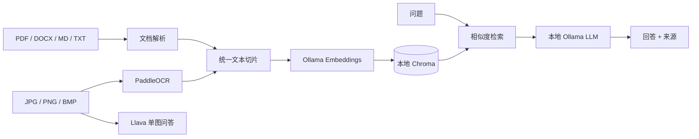

# Local Multimodal RAG

> 本地私有化图文知识库：文档解析 + 图片 OCR 入库，统一使用 Chroma 检索，并由本地 Ollama 模型生成带来源的回答。

## 功能

- PDF、DOCX、Markdown、TXT 解析；图片 JPG、PNG、BMP 使用 PaddleOCR 提取文本。
- 统一切片并保存到本地 Chroma，元数据记录来源文件、内容类型和片段位置。
- 支持批量上传、来源文件列表、按来源删除、混合检索和引用展示。
- Ollama 文本模型 RAG 问答；Llava 单图直接视觉问答。
- Streamlit 页面，上传文件、切换问答模式和调整检索数量。

## 架构



## 快速开始

需要 Python 3.10–3.12 和本机 Ollama。模型首次下载需要联网；下载完成后，应用推理与向量化可在本机运行。

```powershell
ollama pull qwen2.5:7b
ollama pull llava:7b
ollama pull nomic-embed-text
ollama serve
```

另开终端：

```powershell
py -3.11 -m venv .venv
.\.venv\Scripts\Activate.ps1
python -m pip install -r requirements.txt
Copy-Item .env.example .env
streamlit run streamlit_app.py
```

打开 Streamlit 显示的本机地址。若机器资源较小，可在 `.env` 修改文本模型为已安装的轻量模型。PaddleOCR 首次初始化可能下载模型文件；准备离线环境时应先完成依赖和模型缓存。

## 配置

| 变量 | 默认值 | 说明 |
|---|---|---|
| `OLLAMA_BASE_URL` | `http://localhost:11434` | Ollama 服务地址 |
| `OLLAMA_CHAT_MODEL` | `qwen2.5:7b` | RAG 文本模型 |
| `OLLAMA_VISION_MODEL` | `llava:7b` | 单图视觉模型 |
| `OLLAMA_EMBED_MODEL` | `nomic-embed-text` | 本地嵌入模型 |
| `CHROMA_DIR` | `./data/chroma` | 持久化向量库目录 |
| `UPLOAD_DIR` | `./data/uploads` | 本地上传文件目录 |
| `CHUNK_SIZE` / `CHUNK_OVERLAP` | `800` / `120` | 分块长度与重叠字符数 |

## 项目结构

```text
app/
  config.py       环境配置
  ingest.py       文件解析、OCR、文本切片
  store.py        Chroma 初始化和文件管理
  qa.py           RAG 和 Llava 问答
streamlit_app.py  Streamlit 界面
```

## 设计说明与边界

- OCR 文本与文档文本进入同一个集合，通过 `file_type` 元数据保留来源类别。当前检索为向量相似度检索，不代表严格的 BM25 + 向量融合。
- 删除文件按 `source` 元数据执行。上传同名文件会覆盖本地原文件，但旧切片应先删除同名来源再重新入库。
- 扫描版 PDF 当前依赖 PyPDF 文本层；可扩展为逐页渲染后调用 OCR。
- 手写识别和复杂公式识别效果取决于 OCR 模型质量；答案也应结合显示的引用核验。
- Llava 模式只分析当前上传的一张图片，不读取知识库。
- `data/` 和 `.env` 已加入忽略规则，避免把个人资料和本地索引提交到公开仓库。

## 简历描述参考

实现基于 Ollama、PaddleOCR 与 Chroma 的本地多模态 RAG 知识库，支持 PDF/Word/Markdown 文档解析及图片 OCR，统一切片向量化并持久化；构建来源可追溯的混合知识检索问答与 Llava 单图视觉问答流程，并提供 Streamlit 上传、检索参数配置和知识库管理界面。

## License

MIT
